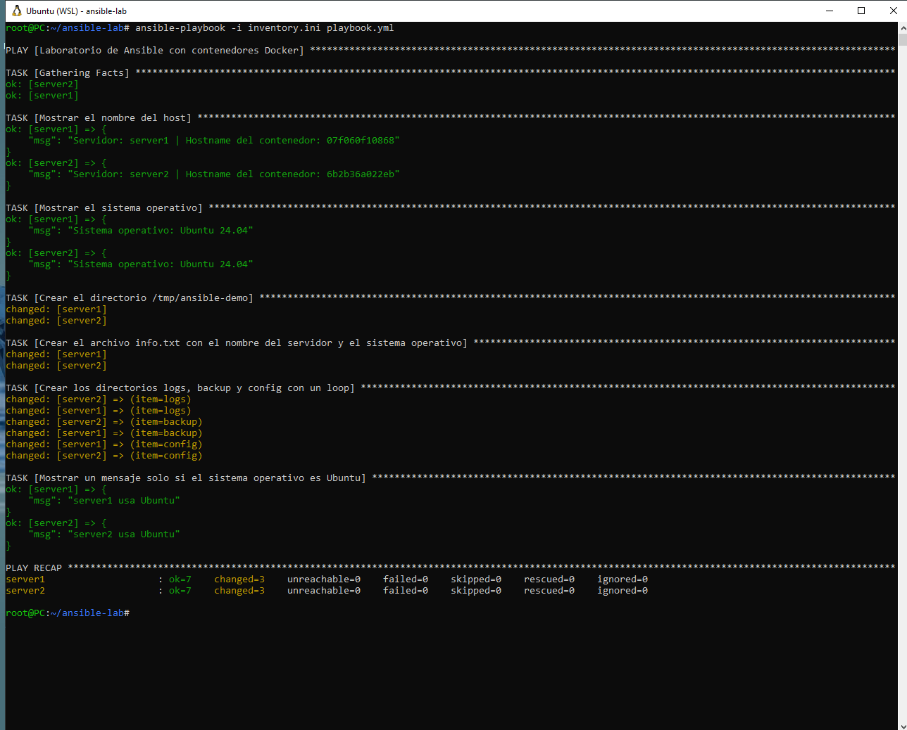

# Parcial 2 - Ansible Lab

Práctica de Ansible: administrar dos servidores Ubuntu (contenedores Docker) con Ansible usando `ansible_connection=docker`.

Todo el contenido está en la carpeta **[ansible-lab](ansible-lab/)**:

| Archivo | Descripción |
|---------|-------------|
| [docker-compose.yml](ansible-lab/docker-compose.yml) | Servidores `server1` y `server2` (Ubuntu 24.04) |
| [inventory.ini](ansible-lab/inventory.ini) | Inventario con conexión `docker` |
| [playbook.yml](ansible-lab/playbook.yml) | Tareas de automatización (loop y condición `when`) |
| [README.md](ansible-lab/README.md) | Objetivo, comandos y captura de la ejecución |

