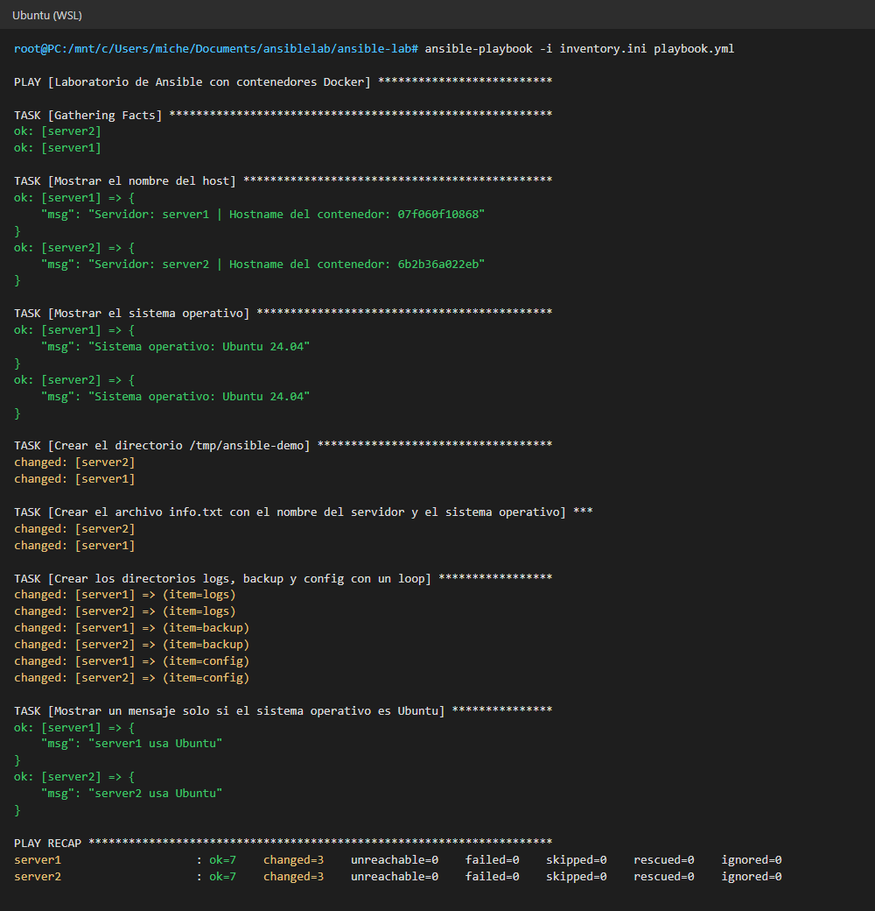

# Ansible Lab: automatización de contenedores Docker con Ansible

## Objetivo de la práctica

Crear dos servidores Ubuntu como contenedores de Docker y administrarlos con Ansible usando la conexión `docker` (sin SSH). El playbook muestra información de cada servidor, crea directorios y archivos, usa un **loop** para crear varios directorios y una **condición** (`when`) para mostrar un mensaje solo en servidores Ubuntu.

## Archivos

```
ansible-lab/
├── docker-compose.yml   # Servidores server1 y server2 (Ubuntu 24.04)
├── inventory.ini        # Grupo [docker] con conexión ansible_connection=docker
├── playbook.yml         # Tareas de automatización
└── README.md
```

## Requisitos

- Docker Desktop con la integración de WSL activada para Ubuntu (*Settings → Resources → WSL integration*).
- Ansible instalado en WSL (`sudo apt install ansible`). Incluye la colección `community.docker` que permite `ansible_connection=docker`.

## Comandos para iniciar los contenedores

```bash
docker compose up -d
docker ps
```

Instalar Python en cada contenedor (Ansible lo necesita para ejecutar sus módulos):

```bash
docker exec -it server1 bash
apt update
apt install -y python3
exit

docker exec -it server2 bash
apt update
apt install -y python3
exit
```

Comprobar la conexión:

```bash
ansible docker -i inventory.ini -m ping
```

## Comando para ejecutar el playbook

```bash
ansible-playbook -i inventory.ini playbook.yml
```

### Qué hace el playbook en cada servidor

1. Muestra el nombre del host.
2. Muestra el sistema operativo.
3. Crea el directorio `/tmp/ansible-demo`.
4. Crea el archivo `/tmp/ansible-demo/info.txt` con el nombre del servidor y el sistema operativo.
5. Crea con un loop los directorios `logs`, `backup` y `config` dentro de `/tmp/ansible-demo`.
6. Muestra un mensaje solo cuando el sistema operativo es Ubuntu.

## Captura de la ejecución exitosa



Resultado del archivo creado en `server1`:

```
$ docker exec server1 cat /tmp/ansible-demo/info.txt
Servidor: server1
Sistema operativo: Ubuntu 24.04
```
